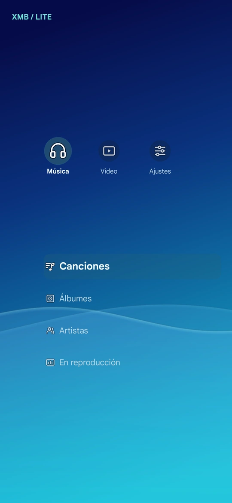
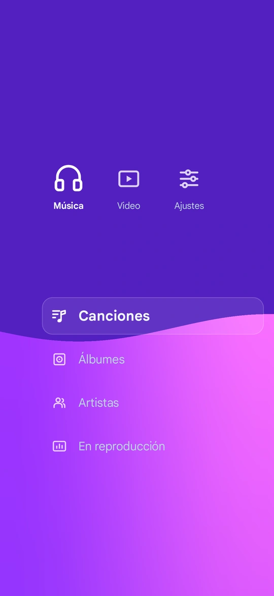

# XMB Lite Player

Reproductor multimedia nativo ultraligero para Android, con un diseño original inspirado en la navegación horizontal y vertical XMB.

**Versión 0.2.0.** Reproduce música local y conserva el menú Música / Video / Ajustes con gestos y controles direccionales. La sección Video sigue en fase de prototipo.

## Fondos animados

Elige el fondo en **Ajustes → Apariencia → Fondo animado**. Capturas tomadas en un Redmi 9T.

En **Ajustes → Apariencia → Rendimiento** puedes elegir entre **Fluido**, **Ahorro** (aprox. 30 FPS) y **Estático**. El ajuste se guarda y se aplica solo al fondo. La navegación mantiene su propia animación.

| Ondas azules | Onda violeta |
| --- | --- |
|  |  |

## Iconografía

El menú usa iconos vectoriales originales y un foco inspirado en la jerarquía visual de XMB. La documentación explica las referencias, la integración Android, las capturas y la licencia MIT de los iconos. [Diseño y licencia de la iconografía](docs/ICONOGRAPHY.md)

## Plataforma objetivo

- Android 16, API 36. Pruebas de renderizado en Redmi 9T ARM64 con crDroid.
- Kotlin + Android View y Canvas: sin Compose, AppCompat ni motor gráfico externo.
- Sin anuncios, telemetría ni permiso de Internet. La biblioteca solicita acceso al audio local.
- En una prueba corta en el Redmi 9T, los fondos alcanzaron 60 FPS en Fluido y unos 30 FPS en Ahorro. En Estático se detuvo el renderizado continuo. El APK de depuración del prototipo visual ocupaba menos de 1 MB. El APK de depuración de 0.2.0 ocupa aproximadamente 5.34 MiB.

## Compilar en Linux Mint sin Android Studio

Requisitos: **JDK 17**, Android SDK con plataforma API 36, build-tools 36.0.0, curl, unzip y sha256sum.

```bash
git clone https://github.com/santiagoCSM/xmb-lite-player.git
cd xmb-lite-player
export ANDROID_HOME="$HOME/Android/Sdk"
bash scripts/gradle.sh assembleDebug
adb devices
adb install -r app/build/outputs/apk/debug/app-debug.apk
```

El script descarga **Gradle 8.13** en `~/.gradle/xmb-lite-bootstrap` si todavía no está presente, verifica SHA-256 y lo ejecuta; no es el Gradle Wrapper oficial porque no incluye el JAR binario `gradle-wrapper.jar`. Si ya dispones de Gradle 8.13, puedes usar `gradle assembleDebug` directamente.

El plugin Android es AGP 8.13.2, con Kotlin 2.2.20. La primera compilación necesita Internet para descargar Gradle y dependencias.

## Controles

- Deslizar **izquierda/derecha**: cambiar categoría.
- Deslizar **arriba/abajo**: recorrer las opciones.
- D-pad o flechas para recorrer el menú. **Enter**, **D-pad central** o **A** del mando para confirmar.
- Toca una categoría o una fila para seleccionarla. Toca la fila seleccionada para abrirla.
- Usa **Atrás**, **Escape** o **B** del mando para regresar al nivel anterior y recuperar su selección.

## Música local

En **Música**, abre **Canciones**, **Álbumes** o **Artistas** y concede acceso cuando el menú lo solicite. Al abrir una canción, la cola usa el orden de la lista que estabas explorando. **En reproducción** muestra la duración y permite pausar, cambiar de pista y saltar a otro punto al tocar la barra o usar izquierda y derecha en el D-pad.

La biblioteca consulta MediaStore fuera del hilo de interfaz. Media3 mantiene la sesión de audio y publica los controles multimedia del sistema. Desde el reproductor puedes reintentar un archivo inaccesible o pasar a otra pista.

## Estructura

- `app/src/main/java/com/santiagocsm/xmblite/XmbMenuView.kt`: menú XMB en Canvas.
- `app/src/main/AndroidManifest.xml`: configuración de Android.
- `app/build.gradle.kts`: versión de SDK y compilación.
- `scripts/gradle.sh`: arranque de Gradle desde terminal.
- `.github/workflows/android.yml`: compila, ejecuta pruebas JVM y lint y publica el APK de depuración como artefacto.

## Estabilización en 0.2.0

- **Confirmado en código.** `showPage()` ya cambiaba la página antes de refrescar el reproductor. En una conexión pendiente, confirmar una canción requería volver a pulsar cuando llegara el controlador. Ahora el reproductor abre con el título solicitado y despacha la selección al conectar. La petición pendiente se descarta al abandonar la pantalla o detenerse la actividad. La sesión y la cola activa siguen perteneciendo al servicio.
- **Confirmado en lint.** Atrás combinaba un callback de plataforma con una implementación obsoleta. Ahora `OnBackPressedDispatcher` maneja Atrás en submenús y deja el gesto de salida al sistema desde la raíz.
- **Confirmado en código.** El menú aceptaba eventos con varios dedos como si fueran un toque o deslizamiento simple. También ordenaba los números de disco y pista de MediaStore como un solo número. Se corrigieron ambos casos, con pruebas JVM para el orden y la restauración de selecciones.
- **Riesgos tratados.** Se invalida la referencia a una consulta o conexión antes de cancelarla, se evita abrir más de una conexión y se permite reintentar después de una desconexión. El permiso de audio se solicita mediante la API de resultados de actividad, con una sola petición activa.
- **Rendimiento.** `TextUtils.ellipsize()` mide la etiqueta y crea una cadena si la recorta. Se reutilizan las etiquetas ajustadas con una caché de 64 entradas por vista y se conserva el recorte de filas al área visible. El controlador se conecta al entrar al reproductor o elegir una canción. Los fondos y sus tres modos conservan su código.
- **Permisos.** El manifiesto combinado incluye lectura de audio, el permiso de almacenamiento solo hasta API 32, permisos de servicio multimedia y `WAKE_LOCK`. Se retiró el acceso al estado de red heredado. El servicio multimedia queda privado.

## Validación de 0.2.0

Ejecuta las mismas comprobaciones que GitHub Actions con:

```bash
bash scripts/gradle.sh assembleDebug testDebugUnitTest lintDebug
```

- Pasaron 9 pruebas JVM sobre orden, agrupación, biblioteca vacía, estados de carga y error, navegación, restauración y formato de tiempo. El proyecto no contiene pruebas instrumentadas.
- Compilaron los APK de depuración (5 594 342 bytes, 5.34 MiB) y release reducida sin firmar (1 261 795 bytes, 1.20 MiB).
- Android Lint terminó con 0 errores, 12 advertencias y 1 sugerencia. Ya no aparece `GestureBackNavigation`.
- El APK de depuración se instaló mediante ADB en un Redmi 9T con Android 16 (API 36) y ARM64.

Con pistas sintéticas se verificaron toque de selección, deslizamientos horizontal y vertical, D-pad, navegación por canciones, álbumes y artistas, regreso a la selección anterior, reproducción/pausa/reanudación, cambio de pista y búsqueda adelante y atrás. La rotación y el cambio a Ajustes de Android conservaron la pista y la reproducción. Una cola de dos pistas cortas avanzó sola, se detuvo al final y permitió reiniciar la última pista. Se comprobó visualmente el recorte con puntos suspensivos y el aviso de error ante un MP3 sintético corrupto.

Con la pantalla apagada y el bloqueo activo, la sesión siguió en reproducción y avanzó de 75.253 a 81.273 s. ADB confirmó pausa, reanudación y cambio de pista a través de la sesión multimedia del sistema mientras seguía bloqueado. También se comprobó que Android detuvo la sesión al revocar el permiso, que la biblioteca volvió a pedir acceso y que el permiso original quedó restaurado.

### Muestra de rendimiento en el Redmi 9T

| Medición | Resultado |
| --- | --- |
| Arranque en frío y vuelta a la tarea con `am start -W` | 912 ms y 86 ms de `TotalTime` |
| Reproductor visible, fondo azul en Fluido, unos 3 s con audio | 187 cuadros, 1 marcado como lento (0.53 %), percentil 95 de 27 ms según `gfxinfo` |
| Audio en segundo plano, ventana de 4 s tras reiniciar `gfxinfo` | 0 cuadros de la app |
| Fondo visible por modo, ventanas de unos 2 s | Fluido 126 cuadros, Ahorro 62, Estático 0 |
| Memoria proporcional del proceso según `meminfo` | 113 837 KiB visible y 73 236 KiB en segundo plano |
| CPU del proceso según `top`, muestra de 1 s | 41.2 % visible y 36.0 % en segundo plano |

Son muestras puntuales de depuración en un solo teléfono. Los dos fondos se verificaron en pantalla y se restauraron las preferencias originales. Queda por comparar el consumo sostenido de cada modo y probar una biblioteca de miles de pistas. La biblioteca vacía se cubrió en la JVM.

### Comprobaciones manuales pendientes

- Probar Atrás desde el borde con la navegación gestual habilitada. El Redmi estaba configurado con botones y se comprobó Atrás por ADB.
- Tocar los controles visibles en la notificación y la pantalla de bloqueo. La sesión del sistema respondió por ADB, pero la automatización no encontró los botones visuales.
- Rechazar el permiso desde el diálogo y volver a concederlo desde Ajustes. La revocación por ADB y el retorno al estado de acceso sí se verificaron.
- Desconectar audífonos, cambiar la salida Bluetooth y probar pérdida y recuperación de enfoque con otra fuente de audio local. No se realizaron llamadas.
- Probar un archivo eliminado tras indexarse, otros formatos incompatibles y una biblioteca vacía en el teléfono. Se comprobó un MP3 corrupto en el Redmi y una biblioteca vacía en la JVM.

XMB Lite Player no utiliza iconos, sonidos ni otros recursos propietarios de Sony.
