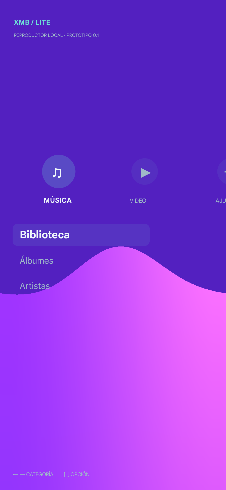

# XMB Lite Player

Reproductor multimedia nativo ultraligero para Android, con un diseño original inspirado en la navegación horizontal y vertical XMB.

**Estado: primera etapa musical.** Reproduce música local y conserva el menú Música / Video / Ajustes con gestos y controles direccionales. La sección Video sigue en fase de prototipo.

## Fondos animados

Elige el fondo en **Ajustes → Apariencia → Fondo animado**. Capturas tomadas en un Redmi 9T.

En **Ajustes → Apariencia → Rendimiento** puedes elegir entre **Fluido**, **Ahorro** (aprox. 30 FPS) y **Estático**. El ajuste se guarda y se aplica solo al fondo. La navegación mantiene su propia animación.

| Ondas azules | Onda violeta |
| --- | --- |
|  |  |

## Plataforma objetivo

- Android 16, API 36. Pruebas de renderizado en Redmi 9T ARM64 con crDroid.
- Kotlin + Android View y Canvas: sin Compose, AppCompat ni motor gráfico externo.
- Sin anuncios, telemetría ni permiso de Internet. La biblioteca solicita acceso al audio local.
- En una prueba corta en el Redmi 9T, los fondos alcanzaron 60 FPS en Fluido y unos 30 FPS en Ahorro. En Estático se detuvo el renderizado continuo. El APK de depuración del prototipo visual ocupaba menos de 1 MB. La etapa musical con Media3 ocupa aproximadamente 5.1 MiB.

## Compilar en Linux Mint sin Android Studio

Requisitos: **JDK 17**, Android SDK con plataforma API 36, build-tools 36.0.0, curl, unzip y sha256sum.

```bash
git clone https://github.com/santiagoCSM/xmb-lite-player.git
cd xmb-lite-player
export ANDROID_HOME="$HOME/Android/Sdk"
bash scripts/gradle.sh assembleDebug
adb devices
adb install -r app/build/outputs/apk/debug/app-debug.apk
```

El script descarga **Gradle 8.13** en `~/.gradle/xmb-lite-bootstrap` si todavía no está presente, verifica SHA-256 y lo ejecuta; no es el Gradle Wrapper oficial porque no incluye el JAR binario `gradle-wrapper.jar`. Si ya dispones de Gradle 8.13, puedes usar `gradle assembleDebug` directamente.

El plugin Android es AGP 8.13.2, con Kotlin 2.2.20. La primera compilación necesita Internet para descargar Gradle y dependencias.

## Controles

- Deslizar **izquierda/derecha**: cambiar categoría.
- Deslizar **arriba/abajo**: recorrer las opciones.
- D-pad o flechas para recorrer el menú. **Enter**, **D-pad central** o **A** del mando para confirmar.
- Toca una categoría o una fila para seleccionarla. Toca la fila seleccionada para abrirla.
- Usa **Atrás**, **Escape** o **B** del mando para regresar al nivel anterior y recuperar su selección.

## Música local

En **Música**, abre **Canciones**, **Álbumes** o **Artistas** y concede acceso cuando el menú lo solicite. Al abrir una canción, la cola usa el orden de la lista que estabas explorando. **En reproducción** muestra la duración y permite pausar, cambiar de pista y saltar a otro punto al tocar la barra o usar izquierda y derecha en el D-pad.

La biblioteca consulta MediaStore fuera del hilo de interfaz. Media3 mantiene la sesión de audio y publica los controles multimedia del sistema. Desde el reproductor puedes reintentar un archivo inaccesible o pasar a otra pista.

## Estructura

- `app/src/main/java/com/santiagocsm/xmblite/XmbMenuView.kt`: menú XMB en Canvas.
- `app/src/main/AndroidManifest.xml`: configuración de Android.
- `app/build.gradle.kts`: versión de SDK y compilación.
- `scripts/gradle.sh`: arranque de Gradle desde terminal.
- `.github/workflows/android.yml`: compilación de APK de depuración y artefacto en Actions.

## Validación de la etapa musical

- Se compiló el APK de depuración y se instaló mediante ADB en un Redmi 9T con Android 16 (API 36) y ARM64.
- Gradle ejecutó la tarea de pruebas unitarias, que quedó sin fuentes de prueba. Lint señaló `GestureBackNavigation` en el manejo del botón Atrás.
- Quedan pendientes las pruebas de reproducción y controles con la pantalla bloqueada, archivos incompatibles y consumo sostenido en el dispositivo.

Este prototipo no utiliza iconos, sonidos ni otros recursos propietarios de Sony.
