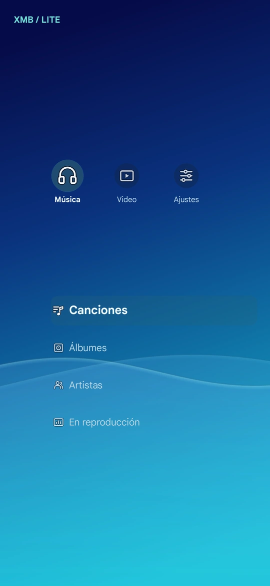
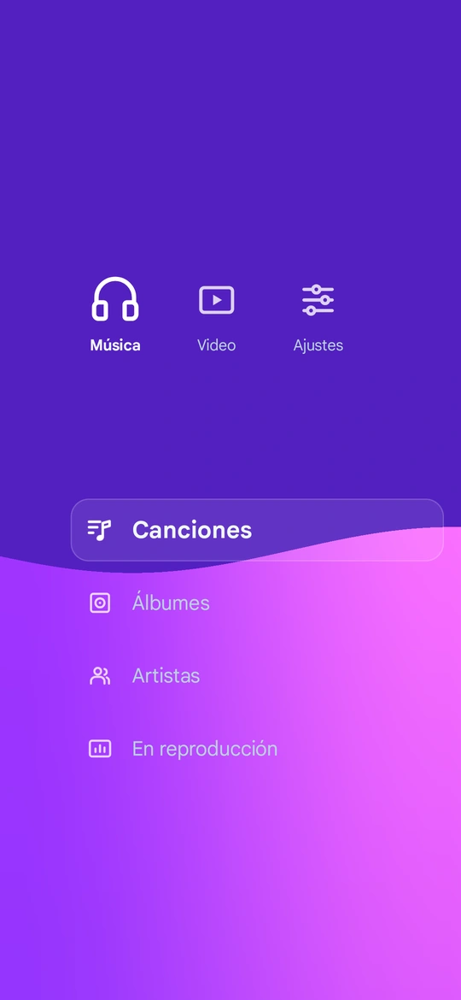

# Iconografía de XMB Lite Player

XMB Lite Player es un proyecto independiente inspirado en la navegación horizontal y vertical de XMB. Sony y PlayStation se mencionan como referencias históricas. El proyecto carece de afiliación o respaldo de Sony.

## Referencias y criterios

PlayStation presentó PSP Theme Toolbox como un conjunto que incluía Custom Theme Converter para asignar imágenes a categorías, opciones y estados de foco, previsualizarlas y exportar un tema `.PTF`. La guía técnica agrupa las categorías en el eje horizontal y los dos niveles de opciones en columnas verticales. Las dimensiones históricas documentadas son:

| Elemento en PSP | Imagen base | Imagen de foco |
| --- | ---: | ---: |
| Categoría horizontal | 64 × 48 px | — |
| Opción vertical de primer nivel | 48 × 48 px | 64 × 64 px |
| Opción vertical de segundo nivel | 32 × 32 px | 48 × 48 px |

La entrada del blog también menciona categorías cuadradas de 48 × 48 px y da 32 × 32 px con foco de 48 × 48 px para las opciones. La tabla anterior sigue el capítulo 3 de la guía técnica. La guía describe imágenes indexadas con canal alfa y recomienda bordes o gradaciones para distinguir las siluetas en fondos variables. Los ejemplos usan reflejos metálicos, bordes suaves y un halo blanco separado del icono. [PlayStation.Blog, How to Make Your Own PSP Themes](https://blog.playstation.com/?p=596) · [Sony, PSP Custom Theme, caps. 2–4 y 6](https://cdn.us.playstation.com/pscomauth/groups/public/documents/webasset/ps_custom_theme-english_pp.pdf)

La app mantiene esa jerarquía con categorías más grandes, filas compactas y foco discreto. Las formas están dibujadas sobre una retícula común con esquinas redondeadas, trazos claros y un borde oscuro translúcido. Ese borde mantiene la silueta sobre una cresta brillante de la onda. El fondo se ve alrededor de cada figura. El realce usa una placa translúcida y una variación de tamaño y opacidad ligada a la transición existente. Los reflejos complejos, el desenfoque y el pulso continuo se reservan a la referencia histórica.

## Dibujos y formato

Cada icono se construyó para este proyecto a partir de formas geométricas y trazos propios. Todos usan Android `VectorDrawable` con un viewport de 24 × 24 y dimensiones intrínsecas de 24 dp. La aplicación dibuja categorías de 24 a 32 dp, filas de 17 a 21 dp, y Atrás, la marca de ajuste y la búsqueda a 14–15 dp. Las acciones deshabilitadas conservan su silueta con menor opacidad. Retroceder y Adelantar reutilizan el salto de cinco segundos del D-pad mediante dos accesos junto a la barra de progreso.

Los archivos están en [app/src/main/res/drawable](../app/src/main/res/drawable). La vista carga y reutiliza una instancia por icono, conserva sus límites y ajusta su escala con Canvas. La familia de iconos prescinde de dependencias nuevas y recursos rasterizados en el APK. Las capturas se guardan aparte, en documentación.

| Uso | Archivos, con prefijo `ic_xmb_` y extensión `.xml` |
| --- | --- |
| Categorías Música, Video y Ajustes | `category_music`, `category_video`, `category_settings` |
| Biblioteca y acceso al reproductor | `songs`, `albums`, `artists`, `now_playing` |
| Menú Video | `local_videos`, `folders` |
| Ajustes y submenús | `appearance`, `animated_background`, `performance`, `information` |
| Transporte y búsqueda | `play`, `pause`, `previous`, `next`, `rewind`, `fast_forward` |
| Navegación, valor aplicado y estados de biblioteca | `back`, `applied`, `access`, `retry` |

## Origen y licencias

Todos los archivos de la tabla son dibujos originales de XMB Lite Player. La guía oficial declara restricciones de copia y redistribución. La descarga del Toolbox tampoco acredita permiso de redistribución de sus plantillas, imágenes o ejecutables. El proyecto consultó la publicación y la guía como referencias y creó los vectores sin trazar ni extraer recursos de Sony, temas, firmware o paquetes de terceros. Android proporciona el formato y el renderizador mediante el SDK. [Condiciones de la guía de Sony](https://cdn.us.playstation.com/pscomauth/groups/public/documents/webasset/ps_custom_theme-english_pp.pdf) · [Documentación de VectorDrawable](https://developer.android.com/develop/ui/views/graphics/vector-drawable-resources)

Los 23 vectores originales se distribuyen bajo [MIT](../app/src/main/assets/licenses/xmb-icons.txt). El repositorio carece de una licencia general declarada. El aviso MIT también viaja en el APK. La licencia de estos dibujos tiene alcance propio y deja pendiente la elección de una licencia para el resto del proyecto.

## Capturas y validación

Las capturas se tomaron en un Redmi 9T (ARM64, Android 16). Los paneles reúnen capturas reales redimensionadas y usan pistas sintéticas. Se revisaron la jerarquía de categorías y opciones, la legibilidad sobre los dos fondos, el icono de ajuste aplicado y los estados del reproductor. Anterior aparece atenuado al comienzo de la cola.

| Música con ondas azules | Música con onda violeta |
| --- | --- |
|  |  |

[Video, Ajustes, Apariencia, Fondo animado y Rendimiento](capturas/iconos-menus.webp) · [Biblioteca, reproducción y pausa](capturas/iconos-reproduccion.webp)

- Gradle compiló el APK de depuración y ejecutó las nueve pruebas JVM existentes. Android Lint registró 0 errores, 13 advertencias y 1 sugerencia. La advertencia nueva sugiere usar una extensión KTX para la traslación de Canvas.
- Se instaló el APK y se verificaron el desplazamiento táctil entre categorías, el D-pad, Atrás, la selección de fondo, la reproducción, la pausa, el cambio de pista y los saltos táctiles de cinco segundos.
- Los 23 XML compilados ocupan 10 406 bytes comprimidos. Los APK de depuración comparados pesaron 5 594 342 bytes antes y 5 839 012 bytes después. El aviso de licencia está incluido en el APK.

La comparación de navegación usó cinco recorridos consecutivos por las tres categorías en cada compilación, con las ondas azules en Fluido.

| Medición puntual | Antes | Con iconos |
| --- | ---: | ---: |
| Arranque en frío según `am start -W` | 913 ms | 1045 ms |
| Duración de la secuencia | 6.81 s | 6.97 s |
| Cuadros marcados como lentos según `gfxinfo` | 3 de 413 (0.73 %) | 4 de 462 (0.87 %) |
| Percentil 95 según `gfxinfo` | 38 ms | 42 ms |

La muestra fue de una ejecución por APK y sus resultados aumentaron levemente. Falta medir la variabilidad entre ejecuciones, otras densidades de pantalla y el consumo sostenido.
